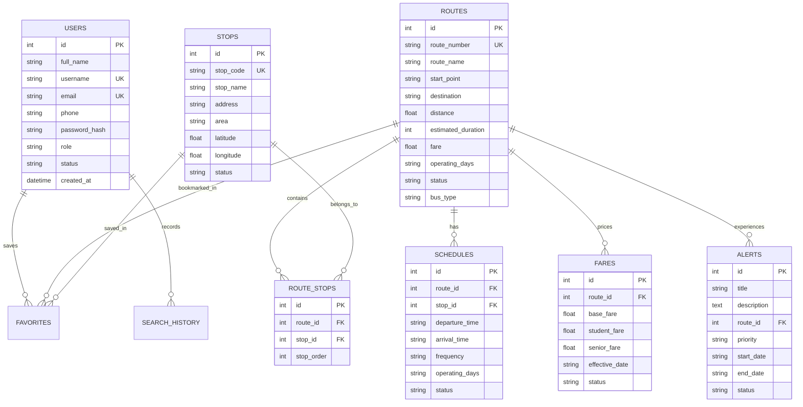

# Public Transport Information Platform

A full-stack web application designed to deliver real-time urban transit intelligence to passengers, transport operators, and transit system administrators.

---

## Table of Contents

- [Project Overview](#project-overview)
- [Problem Statement](#problem-statement)
- [Objectives](#objectives)
- [Key Features](#key-features)
- [User Roles & Permissions](#user-roles--permissions)
- [Technology Stack](#technology-stack)
- [System Architecture](#system-architecture)
- [Database Design](#database-design)
- [REST API Reference](#rest-api-reference)
- [Project Directory Structure](#project-directory-structure)
- [Installation & Setup](#installation--setup)
  - [Backend Setup](#backend-setup)
  - [Frontend Setup](#frontend-setup)
  - [Database Seeding](#database-seeding)
- [Running the Application](#running-the-application)
- [Demo Credentials](#demo-credentials)
- [Future Enhancements](#future-enhancements)
- [Author & Acknowledgments](#author--acknowledgments)

---

## Project Overview

The **Public Transport Information Platform** is an enterprise-grade transit portal providing commuters with instant access to urban bus routes, stop sequences, live timetables, interactive OpenStreetMap route rendering, concession-aware fare calculators, and real-time service disruption bulletins.

The platform provides dedicated role-based portals for:
1. **Passengers / Public Commuters**: Instant journey planning, interactive maps, stops with upcoming buses, live status indicators, and personalized dashboards.
2. **Transport Operators**: Corridor dispatch console for updating operational states (`ON TIME`, `DELAYED`, `SUSPENDED`, `CANCELLED`, `MAINTENANCE`) and broadcasting incident alerts.
3. **Transit Administrators**: Comprehensive CRUD management for Users, Routes, Stops, Schedules, Fares, and Service Alerts with Chart.js analytics.

---

## Problem Statement

Urban commuting is often fraught with uncertainty due to lack of consolidated transit schedules, opaque fare structures, unclear stop sequence layouts, and delayed information during service disruptions. Existing solutions are either proprietary, ad-heavy, or lack unified dispatch and public-facing capabilities. This platform provides an open, accessible, responsive, and real-time transit information network.

---

## Objectives

- Provide intuitive **Journey Planning** that connects starting and destination stops through route sequence matching.
- Render geographic transit routes and stop locations using **OpenStreetMap & Leaflet.js**.
- Support dynamic **Fare Calculation** with concessions for regular passengers, students (50% off), and senior citizens (40% off).
- Enable **Transport Operators** to broadcast live delays and service condition notices instantly.
- Offer **Administrators** full control over lines, timetables, tariffs, and user roles with interactive charts.
- Implement secure **JWT Authentication** and **Role-Based Access Control (RBAC)**.

---

## Key Features

### 1. Passenger & Public Portal
- **Hero Journey Planner**: Find matching routes between any two stops with departure, arrival, duration, fare, and stops count.
- **Interactive Route Map**: Leaflet.js map with custom color-coded pins (Origin in Green, Stops in Blue, Terminus in Red) and polylines.
- **Stop Sequence Timeline**: Vertical step visualization showing the exact progression of stops along a corridor.
- **Bus Stop Directory**: Search stops by name, code, or area with live listings of upcoming bus departures.
- **Public Timetable & Schedules**: Filter departure times, frequency, and operating days by route.
- **Dynamic Fare Calculator**: Computes stage-based ticket fares and concession rates directly from the database.
- **Service Status Board**: Live operational condition badges (`ON TIME`, `DELAYED`, `SUSPENDED`, `CANCELLED`, `MAINTENANCE`).
- **Live Disruption Alerts**: Priority-tagged alerts (`LOW`, `MEDIUM`, `HIGH`, `CRITICAL`).
- **Personalized Dashboard**: Track favorite lines, saved stops, and recent search history.
- **Profile Management**: Update user details, change passwords, or delete account.

### 2. Transport Operator Portal
- Corridor dispatch management.
- Real-time status updater for all active transit lines.
- One-click public bulletin broadcasting for incident notifications.

### 3. Administrator Control Center
- **Analytics Dashboard**: 6 live KPI cards with Chart.js doughnuts and bar charts.
- **User Management**: View, search, edit roles (`USER`, `OPERATOR`, `ADMIN`), toggle status (`ACTIVE`, `INACTIVE`, `SUSPENDED`), and delete users.
- **Route Administration**: Full CRUD operations with distance, duration, fare, fleet type, and operating days.
- **Stop Administration**: Full CRUD operations with GPS coordinates and zone tagging.
- **Schedule Administration**: Full CRUD operations for departure/arrival timetables and peak frequencies.
- **Fare Administration**: Full CRUD operations for base, student, and senior citizen tariffs.
- **Alert Administration**: Full CRUD operations for system-wide and route-specific advisories.

---

## User Roles & Permissions

| Role | Permissions | Access URL |
| :--- | :--- | :--- |
| **GUEST / PUBLIC** | Search routes, view stops, calculate fares, check schedules, read alerts. | `/index.html` |
| **USER (Passenger)** | All guest features + personal dashboard, saved favorites, search history, profile updates. | `/dashboard.html` |
| **OPERATOR** | All user features + corridor dispatch console, update route statuses, broadcast delay advisories. | `/operator/dashboard.html` |
| **ADMIN** | Full administrative privileges, user role assignment, CRUD operations across all entities, analytics. | `/admin/dashboard.html` |

---

## Technology Stack

### Frontend
- **HTML5 & Modern Semantic Markup**
- **CSS3 with Custom Design System** (Variables, glassmorphism, responsive utilities)
- **Bootstrap 5.3.3** (Grid system, modals, dropdowns, toasts)
- **Vanilla JavaScript (ES6+)** with Fetch API and async/await
- **Font Awesome 6.5.1** (Vector icons)
- **Leaflet.js 1.9.4 & OpenStreetMap** (Interactive route and stop mapping)
- **Chart.js** (Dashboard analytics visualizations)

### Backend
- **Python 3.14+**
- **FastAPI 0.110+** (Asynchronous REST API framework)
- **Uvicorn** (ASGI web server)
- **SQLAlchemy 2.0+** (ORM for database operations)
- **Pydantic v2** (Data validation and schema serialization)
- **PyJWT 2.8+** (JSON Web Tokens for secure session authorization)
- **Bcrypt** (Secure salted password hashing)

### Database
- **SQLite 3** (Default local relational database, fully decoupled via SQLAlchemy ORM for seamless migration to **PostgreSQL**).

---

## Database Design



---

## REST API Reference

Interactive API documentation is generated automatically by FastAPI:
- **Swagger UI**: `http://127.0.0.1:8000/docs`
- **ReDoc**: `http://127.0.0.1:8000/redoc`

### Primary Endpoints Table

| Method | Endpoint | Description | Auth Required |
| :--- | :--- | :--- | :--- |
| `POST` | `/api/auth/register` | Register new passenger account | Public |
| `POST` | `/api/auth/login` | Authenticate and obtain JWT token | Public |
| `GET` | `/api/auth/me` | Fetch authenticated user profile | User / Any |
| `GET` | `/api/routes` | List all routes with filters (search, status, bus_type) | Public |
| `GET` | `/api/routes/{id}` | Route details with ordered stops, timetables & alerts | Public |
| `POST` | `/api/routes` | Create new transit route | Admin / Operator |
| `PUT` | `/api/routes/{id}` | Update route details and stop sequences | Admin / Operator |
| `DELETE` | `/api/routes/{id}` | Delete route | Admin |
| `GET` | `/api/stops` | List all stops with keyword search | Public |
| `GET` | `/api/stops/{id}` | Stop details with passing routes & upcoming buses | Public |
| `POST` | `/api/stops` | Add new transit stop | Admin |
| `PUT` | `/api/stops/{id}` | Update transit stop | Admin |
| `DELETE` | `/api/stops/{id}` | Delete transit stop | Admin |
| `GET` | `/api/schedules` | Query timetables by route, stop, or keyword | Public |
| `POST` | `/api/schedules` | Create timetable schedule entry | Admin / Operator |
| `GET` | `/api/fares` | List official fare tariffs | Public |
| `POST` | `/api/fares/calculate` | Calculate stage fare and student/senior concessions | Public |
| `GET` | `/api/alerts` | List service alerts with priority and status filters | Public |
| `POST` | `/api/alerts` | Publish service disruption alert | Admin / Operator |
| `POST` | `/api/search/routes` | Journey Planner route matching algorithm | Public |
| `GET` | `/api/favorites` | Retrieve authenticated user's favorite routes & stops | User |
| `POST` | `/api/favorites` | Add route/stop to user favorites | User |
| `DELETE` | `/api/favorites/{id}` | Remove item from favorites | User |
| `GET` | `/api/dashboard/user` | Passenger dashboard statistics and recent activity | User |
| `GET` | `/api/dashboard/admin` | Admin dashboard metrics and breakdown analytics | Admin |
| `POST` | `/api/operator/update-status` | Update route operational status & broadcast advisory | Operator / Admin |

---

## Project Directory Structure

```
public-transport-platform/
│
├── backend/
│   ├── app/
│   │   ├── __init__.py
│   │   ├── database.py         # SQLAlchemy engine, session & SQLite DB
│   │   ├── models.py           # Relational ORM models
│   │   ├── schemas.py          # Pydantic schemas for request/response
│   │   ├── security.py         # Bcrypt hashing & PyJWT token generator
│   │   ├── dependencies.py     # Auth dependencies & RBAC role checks
│   │   ├── main.py             # FastAPI app, CORS, static file mount & routes
│   │   │
│   │   ├── routes/
│   │   │   ├── auth_routes.py
│   │   │   ├── user_routes.py
│   │   │   ├── route_routes.py
│   │   │   ├── stop_routes.py
│   │   │   ├── schedule_routes.py
│   │   │   ├── fare_routes.py
│   │   │   ├── alert_routes.py
│   │   │   ├── favorite_routes.py
│   │   │   ├── search_routes.py
│   │   │   ├── admin_routes.py
│   │   │   └── operator_routes.py
│   │   │
│   │   └── services/
│   │       ├── route_service.py
│   │       ├── schedule_service.py
│   │       ├── fare_service.py
│   │       └── alert_service.py
│   │
│   ├── requirements.txt        # Python dependency declarations
│   └── seed_data.py            # Comprehensive database populator
│
├── frontend/
│   ├── index.html              # Landing page with Journey Planner widget
│   ├── login.html              # Passenger login
│   ├── register.html           # Passenger registration
│   ├── dashboard.html          # Passenger personal dashboard
│   ├── routes.html             # Routes catalog & search
│   ├── route-details.html      # Interactive Leaflet map & stop timeline
│   ├── stops.html              # Stops directory & upcoming buses
│   ├── schedules.html          # Public timetables
│   ├── fares.html              # Fare tariffs & dynamic calculator
│   ├── service-status.html     # Live network operational status
│   ├── alerts.html             # Service disruption bulletin feed
│   ├── profile.html            # User profile management
│   ├── favorites.html          # Saved favorite routes & stops
│   │
│   ├── admin/
│   │   ├── login.html          # Admin portal login
│   │   ├── dashboard.html      # Admin Analytics Dashboard (Chart.js)
│   │   ├── users.html          # User Management CRUD
│   │   ├── routes.html         # Route Administration CRUD
│   │   ├── stops.html          # Stop Administration CRUD
│   │   ├── schedules.html      # Schedule Administration CRUD
│   │   ├── fares.html          # Fare Administration CRUD
│   │   └── alerts.html         # Service Alert Administration CRUD
│   │
│   ├── operator/
│   │   ├── dashboard.html      # Operator Dispatch Control
│   │   └── service-status.html # Incident status broadcast
│   │
│   ├── css/
│   │   ├── style.css           # Global transport theme styles
│   │   ├── auth.css            # Authentication styling
│   │   ├── dashboard.css       # Passenger dashboard widgets
│   │   ├── routes.css          # Journey step cards & timeline
│   │   └── admin.css           # Admin & Operator sidebar layout
│   │
│   └── js/
│       ├── api.js              # Unified API client & navbar state manager
│       ├── auth.js             # Authentication & validation
│       ├── dashboard.js        # Passenger dashboard logic
│       ├── routes.js           # Routes & Leaflet map integration
│       ├── stops.js            # Stops & station marker maps
│       ├── schedules.js        # Schedules controller
│       ├── fares.js            # Fare matrix & live calculator
│       ├── alerts.js           # Service status & alerts feed
│       ├── profile.js          # Profile editor & password change
│       ├── admin.js            # Admin CRUD & Chart.js renderer
│       └── operator.js         # Operator live status updater
│
├── test_platform.py            # End-to-end integration test suite
└── README.md                   # Comprehensive project documentation
```

---

## Installation & Setup

### 1. Prerequisites
- Python 3.10+ installed on your system.
- Git (optional, for cloning).

### 2. Backend Setup
1. Open a terminal in the project directory:
   ```bash
   cd public-transport-platform/backend
   ```
2. (Optional) Create and activate a Python virtual environment:
   ```bash
   # Windows (PowerShell)
   python -m venv venv
   .\venv\Scripts\Activate.ps1

   # macOS / Linux
   python3 -m venv venv
   source venv/bin/activate
   ```
3. Install required backend dependencies:
   ```bash
   pip install -r requirements.txt
   ```

### 3. Database Seeding
Populate the database with realistic sample routes, stops, schedules, fares, and demo accounts:
```bash
python seed_data.py
```

### 4. Running the Application
Start the FastAPI server:
```bash
python -m uvicorn app.main:app --host 127.0.0.1 --port 8000 --reload
```

The unified platform will now be running at:
- **Web Application**: `http://127.0.0.1:8000/index.html` (or `http://127.0.0.1:8000/`)
- **Swagger API Documentation**: `http://127.0.0.1:8000/docs`
- **ReDoc Interactive Reference**: `http://127.0.0.1:8000/redoc`

*(Note: If you prefer running the frontend separately via VS Code Live Server on port 5500, the API client automatically connects to `http://127.0.0.1:8000` with CORS enabled).*

---

## Demo Credentials

| Role | Username / Identifier | Password | Access Level |
| :--- | :--- | :--- | :--- |
| **System Administrator** | `admin` *(or `admin@transport.gov`)* | `admin123` | Full Admin Dashboard & All CRUD operations |
| **Transit Operator** | `operator` *(or `operator@transport.gov`)* | `operator123` | Corridor Dispatch & Live Status Broadcasting |
| **Passenger User 1** | `john_doe` *(or `john@example.com`)* | `password123` | Passenger Dashboard, Favorites, History |
| **Passenger User 2** | `sarah_m` *(or `sarah@example.com`)* | `password123` | Passenger Dashboard |
| **Passenger User 3** | `rahul_k` *(or `rahul@example.com`)* | `password123` | Passenger Dashboard |

---

## Future Enhancements

- **Real-Time GPS Vehicle Tracking**: Integration with WebSockets for live bus icon movement along map polylines.
- **QR Code Ticketing & Payment Gateway**: Direct ticket booking with UPI, Razorpay, or Stripe integration.
- **Multilingual Support**: Internationalization (i18n) for regional language support.
- **Push Notifications & SMS Alerts**: Integration with Firebase Cloud Messaging and Twilio for instant SMS dispatch on critical delays.
- **Mobile Native Apps**: React Native or Flutter companion applications utilizing the existing REST APIs.

---

## Author & Acknowledgments

- Developed for **Web Technology Full-Stack Demonstration**.
- Built with **Python, FastAPI, SQLAlchemy, SQLite, Bootstrap 5, Leaflet.js, and Chart.js**.
